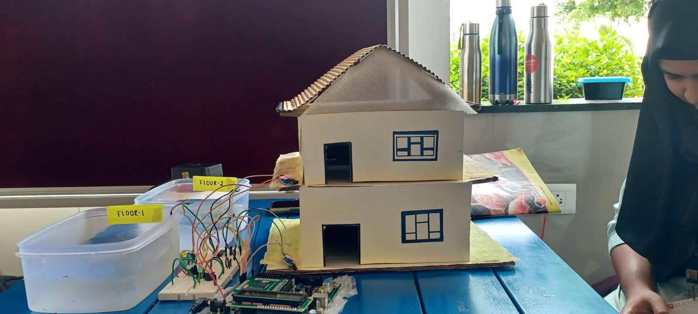

# Fire Detection and Extinguishing System using RTOS

**Platform:** LPC1768 (ARM Cortex-M3) | **RTOS:** RTX Kernel (Keil MDK) | **Language:** Embedded C

A real-time, multi-floor fire detection and suppression system built on the LPC1768 microcontroller using RTX RTOS task scheduling and event flags. Detects fire via IR flame sensors and autonomously triggers buzzer alarms and DC water pumps per floor.

---

## Project Overview

| Property | Details |
|---|---|
| Microcontroller | NXP LPC1768 (ARM Cortex-M3) |
| RTOS | Keil RTX Kernel |
| Sensor | IR Flame Sensor (YG1006 phototransistor, 760–1100 nm) |
| Actuators | 2x Buzzer, 2x DC Pump (via ULN2003 relay driver) |

---

## System Architecture

The system models a two-floor building, with each floor independently monitored and controlled. This structure was chosen deliberately to demonstrate multi-task concurrency: a single-floor system would not require more than one response task, whereas two floors introduce competing fire conditions that must be handled simultaneously and independently by the RTOS scheduler.

The RTX kernel (Real-Time eXecutive by Keil) is a preemptive, priority-based RTOS for ARM Cortex-M microcontrollers. It provides deterministic task scheduling, event flags for inter-task signalling, and task management APIs — all running directly on bare-metal hardware with no operating system underneath. Each task is assigned a fixed priority; when a higher-priority task becomes ready, the kernel preempts the current task immediately.

```
+--------------------------------------------------------+
|                    RTX RTOS Kernel                     |
|                                                        |
|  job1 (prio 2) ---> Fire Detection (sensing loop)     |
|      |                                                 |
|      +--- both floors ---> job2 (prio 4)              |
|      +--- floor 1 only --> job3 (prio 5)              |
|      +--- floor 2 only --> job4 (prio 6)              |
|      +--- no fire      --> job5 (prio 7)              |
+--------------------------------------------------------+
         ^                        v
   Flame Sensors           Buzzers + DC Pumps
   (GPIO inputs)           (GPIO outputs via relay)
```

Tasks communicate exclusively through RTX event flags (`os_evt_set` / `os_evt_wait_or`) — no shared memory, no polling delays.



---

## RTOS Design Details

The design applies core RTOS concepts to a physical, multi-zone problem:

- **Preemptive multitasking** — five concurrent tasks run under the RTX scheduler. The fire detection task (job1) holds the highest priority so sensor reads are never delayed by actuation tasks.
- **Priority-based dispatch** — each fire condition (both floors, floor 1 only, floor 2 only, no fire) maps to a dedicated task at a distinct priority. The kernel guarantees that the correct task runs first when multiple events are pending.
- **Event-flag synchronization** — response tasks block on `os_evt_wait_or` and consume zero CPU while waiting. job1 unblocks exactly the relevant task via `os_evt_set`, avoiding polling loops and unnecessary context switches.
- **Task isolation** — each response task owns its floor's actuators exclusively. There is no shared state between tasks; all coordination is through flags, which eliminates race conditions without needing mutexes.

### Tasks

| Task | Priority | Role |
|------|----------|------|
| `job1` | 2 | Reads both flame sensors; dispatches events to response tasks |
| `job2` | 4 | Both floors on fire — activates all buzzers and pumps |
| `job3` | 5 | Floor 1 fire — activates floor 1, deactivates floor 2 |
| `job4` | 6 | Floor 2 fire — activates floor 2, deactivates floor 1 |
| `job5` | 7 | No fire — deactivates all actuators |

### Kernel Objects Used

- **Task Management** (`os_tsk_create`, `os_tsk_prio_self`) — enables true concurrency on the Cortex-M3; each task runs as an independent thread with its own stack
- **Event Flags** (`os_evt_set`, `os_evt_wait_or`) — zero-latency inter-task signalling without busy-waiting; blocked tasks are resumed by the kernel in O(1) time

### Optimization Techniques

- **Loop Unrolling** — sensor read loop structured to minimize branch overhead
- **Register Allocation** — GPIO helper functions (`controlBuzzer`, `controlRelay`) optimized to keep frequent variables in registers
- **Code Minimization** — bitwise GPIO operations reduce instruction count vs. read-modify-write sequences

---

## Test Cases

| Test Case | Sensor 1 | Sensor 2 | Expected Behaviour |
|-----------|----------|----------|--------------------|
| Normal operation | 0 | 0 | All actuators OFF |
| Both floors on fire | 1 | 1 | job2: all buzzers + pumps ON |
| Floor 1 fire only | 1 | 0 | job3: floor 1 ON, floor 2 OFF |
| Floor 2 fire only | 0 | 1 | job4: floor 2 ON, floor 1 OFF |

---

## Repository Structure

```
rtos-fire-detection/
├── src/
│   └── fire_detection.c    # Full annotated source code
├── docs/
│   ├── hardware.jpg        # Hardware setup photo
│   └── project_report.pdf  # College project report (KLE Tech, Jan 2024)
└── README.md
```

---

## Build Instructions

1. Open **Keil uVision** (MDK-ARM)
2. Create a new project targeting the **LPC1768**
3. Add `src/fire_detection.c` to the project
4. Add the **RTX RTOS** component from the CMSIS pack
5. Build and flash via JTAG/SWD

> **Note:** This project requires the Keil RTX kernel headers (`RTL.h`) and the LPC17xx CMSIS headers (`LPC17xx.h`). Both are bundled with Keil MDK.

---

## Authors

| Name | Roll No. |
|------|----------|
| Raksha Kulal | 01FE21BEE005 |
| Shrinidhi Shambhoji | 01FE21BEE011 |
| Krithika Patgar | 01FE21BEE017 |
| Parveen Khatal | 01FE21BEE019 |

**Department of Electrical & Electronics Engineering**
KLE Technological University, Hubballi — January 2024
